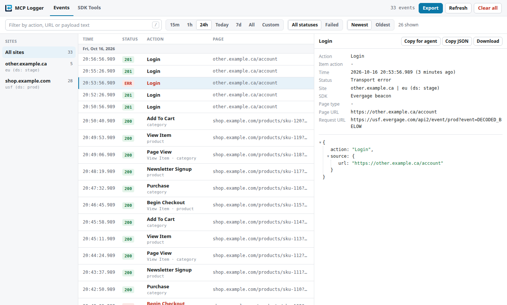
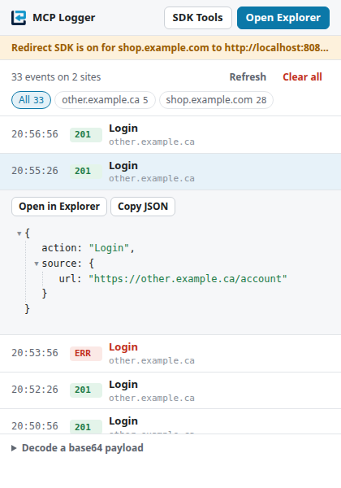
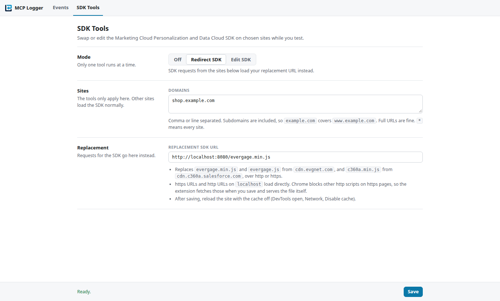

# Interaction Studio (MCP) Logger

A Chrome extension that logs every event a page sends to Salesforce Marketing Cloud Personalization (formerly Interaction Studio, served by `evergage.min.js`) and to the Data Cloud Web SDK (`c360a.min.js`). The payloads are base64 encoded, so the extension decodes them and shows formatted JSON, which makes debugging a site's personalization setup much quicker for developers and testers.

"MCP" here means Marketing Cloud Personalization, not the Model Context Protocol.

## Installation

1. Unzip the extension (the latest build is in `dist/`).
2. Open `chrome://extensions`.
3. Turn on Developer mode.
4. Click **Load unpacked** and pick the unzipped folder.
5. Pin the extension.

## Use

1. Open a site that uses Marketing Cloud Personalization. Some examples: alc.ca, becu.org, macro.com.ar, lendingclub.com, zebra.com.
2. When an event is recorded, the icon changes color for a moment.
3. The popup lists the latest events across all sites (filter by site with the chips). Click an event to see its payload, copy it, or open it in the Explorer. A strip at the top says when Redirect or Edit SDK is on. **Decode a base64 payload** decodes an `event=` value you paste.
4. **Open Explorer** shows every event: sites on the left (or All sites), the event stream in the middle (time to the millisecond, status, action, page) and the selected event's details and payload on the right. Filter by text, time range and status (All or Failed), and sort newest or oldest first. Keys: `/` to search, `j`/`k` or the arrow keys to move between events, `Esc` to leave the search box.

Both `GET` requests with an encoded payload and `POST` requests with form data or a raw body are supported. The pages follow the system's light or dark mode.

## Export

In the Event Explorer, **Export** works on the events in the current view (the selected site with the current filters) or on all sites with the same filters:

- **Copy for agent (Markdown):** copies a Markdown summary to paste into an AI assistant: what was exported and the filters used, a table of actions with counts and failures, the pages seen, failed requests, and then every event (oldest first) with its page, SDK, request URL and decoded payload. Each payload is cut at 4,000 characters so the text fits in a prompt.
- **Download Markdown:** the same document as a `.md` file, with full payloads.
- **Download JSON:** the same data as JSON (`summary` plus `events`), for scripts or other tools.
- **Download HTML report:** a single HTML file that works offline and needs no scripts: summary, pages, and one expandable entry per event. It follows the system's light or dark mode.

**Hide personal data** is on by default. It replaces email addresses (anywhere, including URL-encoded ones in page URLs) and the values of fields such as email, phone, first and last name, address, postal code, birth date, password, token and cookie with `[masked]`. Turn it off if you need the real values.

The event details panel also has **Copy for agent** for the selected event, plus **Copy JSON** and **Download JSON** for its raw payload.

## SDK Tools

Open **SDK Tools** from the popup or the Explorer's top bar. Pick a **Mode** (Off, Redirect SDK or Edit SDK), list the **Sites** it applies to, and Save. Only one mode runs at a time, because Edit blocks the SDK request that Redirect would replace.

**Sites:** the tools only apply on the domains you list (subdomains included, so `example.com` covers `www.example.com`; `*` means every site). Every other site loads the SDK normally. Chips under the box add sites from your open tabs.

**Redirect SDK:** requests the listed sites make for `evergage(.min).js` on `cdn.evgnet.com` or `c360a(.min).js` on `cdn.c360a.salesforce.com`, over http or https, go to the URL you enter instead:

- An https URL, or an http URL on `localhost` or `127.0.0.1`, loads directly.
- Chrome blocks any other http script on an https page (mixed content). For those URLs the extension fetches the file when you save and serves its contents in place of the SDK, so it still runs where the SDK tag is. Click **Fetch again** after changing the file. Files up to 1,400 KB work this way.
- Reload the site with the cache off after saving, so the browser does not reuse a cached SDK.

**Edit SDK:** load an SDK from a URL or a file, edit it, and compare it with the original or download it. Enter the **Page to open** and click **Inject and open**: the edited SDK is saved, the page's site is added to Sites if needed, and the page opens in a new tab. On the listed sites, the SDK request is answered with your edited copy, so it runs exactly where the SDK tag is, until you switch the mode off. Pages that never load the SDK are left alone.

An edited file over 1,400 KB is too large to serve that way. Then the CDN SDK is blocked and your copy is injected when the page starts loading instead; it can run after the page's own inline scripts, and a strict page CSP can block it.

## Development

- Unit tests for the export code: `cd tests && npm test` (Node's built-in test runner, no install needed).
- Browser smoke test (loads the unpacked extension in Chrome with Puppeteer): `cd tests && npm install && npm run test:smoke`. Optional environment variables: `CHROME_PATH` (a local Chrome or Chromium), `HEADLESS=1`, and `CHROME_ARGS` (for example `--no-sandbox` where the sandbox is unavailable).
- Chrome Web Store privacy text (permission justifications): `docs/chrome-web-store.md`.
- Package a release: `./package.sh` writes `dist/interaction-studio-mcp-logger-v<version>.zip`, without tests and dev files.
